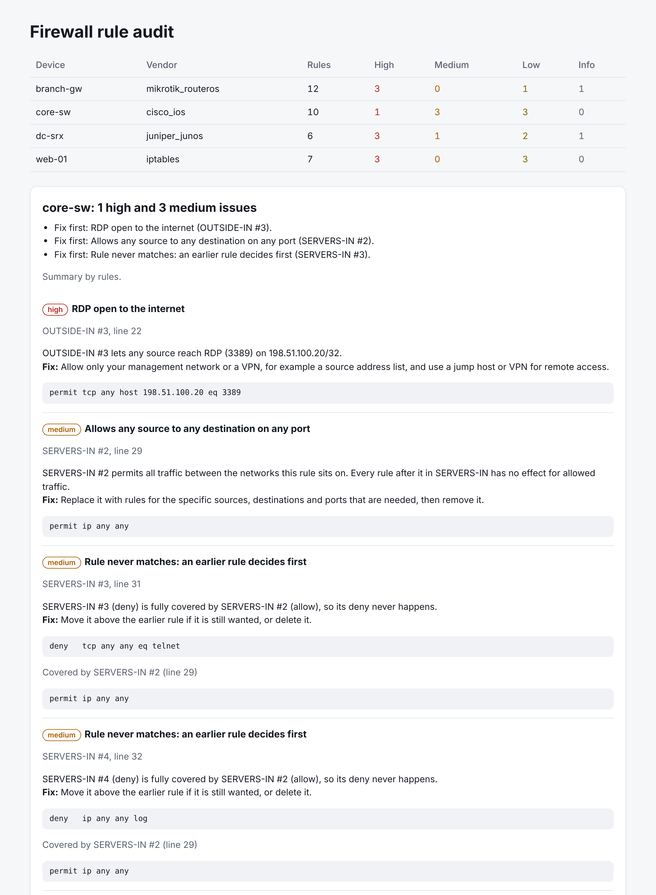

# Firewall rule auditor

[](https://github.com/arafathossein/firewall-rule-auditor/actions/workflows/tests.yml)

**Find the firewall rules that put you at risk.** Point it at a MikroTik export, a Cisco IOS config, a Juniper SRX config or `iptables-save` output, and it reports any-to-any rules, admin and database ports open to the internet, rules that can never match, missing final drops and rules nobody documented. Each finding names the rule, the line number, why it matters and how to fix it.

It reads config files only. It never logs in to a device and never changes anything.

Built by [AFYRA Technologies](https://afyra-iota.vercel.app). Pairs with [network-config-drift-detector](https://github.com/arafathossein/network-config-drift-detector), which catches risky changes day by day; this tool reviews the whole rule base at once.



*Rendered from the bundled sample configs with `fw-audit demo`. All devices and addresses are fictional.*

## Why

Firewall rule bases grow for years and rarely shrink. A rule added for a vendor visit stays forever. A `permit ip any any` added during an outage quietly turns every rule below it into decoration. Auditors ask for a rule review, and it ends up as a week of reading configs by hand.

This tool does the first pass in seconds, the same way every time, so people can spend their time deciding what to change.

## What it checks

| Check | Severity | What it finds |
| --- | --- | --- |
| `any-any` | High from the internet side, medium inside | Allow rules with any source, any destination, any port |
| `exposed-service` | High (medium for SSH) | Any source on the internet can reach RDP, SMB, Telnet, FTP, SNMP, VNC, WinRM, Winbox, the RouterOS API, SQL Server, MySQL, PostgreSQL, Redis, MongoDB, Elasticsearch, Memcached or the Docker API; on a MikroTik router, also its web admin |
| `all-ports-open` | High | Every TCP or UDP port open to any source |
| `default-allow` | High for traffic to the device, medium for forwarded traffic | MikroTik chains without a final drop, iptables `ACCEPT` policy without a final drop, Junos `default-policy permit-all` |
| `shadowed` | Medium | A rule that can never match because an earlier rule with the opposite action already covers it |
| `redundant` | Low | A rule that repeats what an earlier rule already does |
| `no-comment` | Low | Allow rules without a comment, remark or description |
| `disabled` | Info | Disabled or deactivated rules left in the config |

### How it decides "from the internet"

- **MikroTik:** input and forward rules with no source limit that arrive on a WAN-like interface list or interface, or on any interface. `in-interface-list=LAN` is trusted; `!LAN` is not.
- **Cisco IOS:** access lists applied inbound on an interface whose name or description says outside, WAN, internet, ISP or untrust, or whose own name does.
- **Juniper SRX:** policies from a zone named untrust, internet, outside, public and similar. Address-book entries, address sets and custom applications are resolved to real addresses and ports.
- **iptables:** INPUT and FORWARD rules with no source limit, except on loopback, Docker, bridge and VPN interfaces.

### Avoiding false alarms

- Rules that only match replies (`established`, `RELATED,ESTABLISHED`) are never reported as open.
- A rule with conditions the tool doesn't model (rate limits, TCP flags, source ports, time ranges) is never used to call another rule shadowed.
- Unresolved names (address lists, object groups) count as restricted, never as "any".
- Web ports on a server's INPUT chain are the service, not an admin interface.

## Quick start

```bash
python -m venv .venv && source .venv/bin/activate     # Windows: .venv\Scripts\activate
pip install -e ".[dev]"

fw-audit demo                                   # four sample firewalls, report in reports/
fw-audit scan edge.rsc core-sw.cfg dc-srx.cfg   # vendor detected from each file
fw-audit scan server.rules --vendor iptables --fail-on high
pytest                                          # 45 tests
```

Each run writes `fw-audit.html`, `.md`, `.json` and `.csv` to `reports/`. The CSV opens in Excel as a remediation tracker.

### Getting the configs

| Vendor | Command |
| --- | --- |
| MikroTik RouterOS | `/export file=fw` (block or terse format both work) |
| Cisco IOS / IOS-XE | `show running-config` |
| Juniper SRX | `show configuration \| display set` |
| Linux | `sudo iptables-save > host.rules` |

### In a pipeline

Use the exit code to stop a change that adds a risky rule:

```bash
fw-audit scan candidate.cfg --fail-on high       # exit 2 if any high finding
fw-audit scan candidate.cfg --fail-on high --ignore no-comment,disabled
```

Exit codes: `0` no finding at the `--fail-on` level, `1` a file could not be read or parsed, `2` a finding reached `--fail-on`.

## Optional model summary

By default each device gets a short summary built from the findings: the counts and the three things to fix first. To have a language model write it instead, point it at any OpenAI-compatible endpoint, including Ollama on your own server:

```bash
export LLM_BASE_URL=http://127.0.0.1:11434/v1 LLM_MODEL=llama3.1:8b
```

Only the finding titles and details are sent, never the config. Internal addresses (10/8, 172.16/12, 192.168/16, loopback, link-local, CGNAT) are replaced with `[internal]` unless `MASK_INTERNAL_IPS=false`. If the model fails, the built-in summary is used and the report says so.

## Limits

- IPv4-centred. IPv6 rules are parsed where the vendor syntax matches, but `/ipv6 firewall` on MikroTik and `ip6tables` are not read yet.
- Cisco ASA, Fortinet, Palo Alto and pfSense are not supported yet.
- NAT is not modelled. A port forward is judged by the filter rule that allows it, which is where RouterOS and SRX enforce it.
- The tool can't know your intent. A finding is a question for a person, not a verdict.

## Project layout

```
src/fw_audit/
  parsers/        mikrotik.py, cisco.py, junos.py, iptables.py → one Rule model
  model.py        rules, addresses, port ranges, coverage logic
  checks.py       the eight checks
  summary.py      built-in and optional model summary, IP masking
  report.py       HTML, Markdown, JSON, CSV
  cli.py
samples/configs/  one fictional firewall per vendor
```

## Roadmap

- MikroTik IPv6 and ip6tables
- Cisco ASA and FortiGate parsers
- Unused-rule detection from hit counters
- Compare two audits to show what improved

## License

MIT, see [LICENSE](LICENSE).
